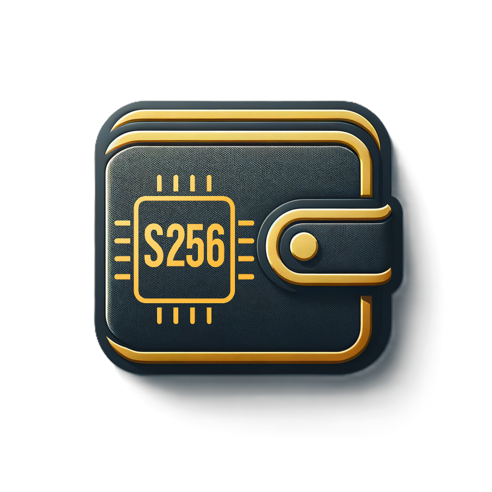

# S256 Wallet

<p align="center">
  
</p>

<p align="center">
  <strong>Mobile wallet for SHA256coin (S256)</strong><br>
  Built with Flutter for Android & iOS
</p>

<p align="center">
  <a href="https://sha256coin.eu">Website</a> •
  <a href="https://explorer.sha256coin.eu">Explorer</a>
</p>

## Features

- **BIP39 Seed Phrase Support**: Create or restore wallets using 12 or 24-word recovery phrases.
- **Cross-Platform Compatibility**: Uses standard derivation path `m/44'/0'/0'/0/0` (same as Web Wallet 2.0).
- **Advanced Recovery**: Support for raw private key (WIF) recovery and generation.
- **Fully Non-Custodial Sending**: Transactions are built and signed locally on-device before broadcast.
- **Send and Receive**: Seamless S256 transfers with support for modern and legacy address formats.
- **Advanced Send (Coin Control)**: Manual UTXO selection with input scanning, select-all/clear, and confirmation-aware filtering.
- **Transaction Preview**: Clear pre-send summary of selected inputs, send amount, estimated fee, and expected change.
- **QR Code Scanning**: Supports BIP21 URI format for easy payments.
- **Payment Requests**: reads `sha256coin:` requests and web wallet pay links, and shares them from Receive.
- **Balance Chart & Status Line**: stepped balance history with a touch readout, and live block height, hashrate, peers and price.
- **Transaction Tracking**: Real-time history with smart confirmation tracking.
- **Flexible Pending Logic**: Sending is not blocked globally by pending transactions when selected UTXOs are free to spend.
- **Compliance Surfaces**: In-app Regulatory Notice and updated About/Exchange informational views.
- **Biometric Security**: Protect your wallet and recovery phrase with fingerprint or face recognition.
- **Secure Storage**: Sensitive keys and mnemonics are stored in encrypted secure storage.

## Release 1.7.1

Version `1.7.1` (Play Store versionCode 10):

- **Scrolling status line:** when the network line at the top does not fit the screen, it now scrolls by itself, slowly and smoothly in a loop. It pauses while you touch it and stays still when the phone asks for reduced motion.
- **Markets tab:** updated.
- Camera scanner library updated (mobile_scanner 7.5.0).

## Release 1.7.0

Version `1.7.0` (Play Store versionCode 9). The look of S256 web wallet 3.0 on the phone, faster sends, and a real balance chart:

- **Faster send:** a wallet with many UTXOs no longer makes one `gettxout` call per UTXO; the script comes from the `scantxoutset` answer. Advanced send (coin control) gets the same speed-up.
- **Balance chart:** time along the bottom, a stepped line, round gridlines with values, green and red markers for coins in and out, and a readout with date, balance and change when you touch the chart.
- **Status line:** connection, block height, hashrate, peers and S256 price at the top of the wallet.
- **Digital Platinum look:** matches sha256coin.eu and web wallet 3.0, with a redesigned balance card, Network Status screen, dialogs and bottom bar.
- **24h price change** from the explorer, shown only while there is a live price.

Release 1.6.6 added payment requests (`sha256coin:` requests and web wallet pay links, with the name and note shown as not verified) and a Send button on each contact.

Release 1.6 (2026-08-02) added batch-send decisions and retry, safer migration with backup-first guidance, the Address Book in the bottom navigation, and a static Receive QR for reliable scanning on tablets.

See [CHANGELOG.MD](CHANGELOG.MD) for full release history.

## Quick Start

```bash
# Install dependencies
flutter pub get

# Run in development (uses public RPC)
flutter run

# Build APK
flutter build apk

# Build with custom RPC
flutter build apk --release --obfuscate --split-debug-info=build/app/outputs/symbols --dart-define-from-file=dart_defines.json
```

## Configuration

The wallet connects to the public RPC proxy at `https://sha256coin.eu/rpc` by default (no authentication required).

For custom RPC node, create `dart_defines.json`:

```json
{
  "RPC_URL": "http://your-rpc:port",
  "RPC_USER": "your_user",
  "RPC_PASSWORD": "your_password"
}
```

## Build for Production

```bash
# Android APK
flutter build apk --release --dart-define-from-file=dart_defines.json

# Android App Bundle (Play Store)
flutter build appbundle --release --obfuscate \
  --split-debug-info=build/app/outputs/symbols \
  --dart-define-from-file=dart_defines.json

# iOS
flutter build ios --release --dart-define-from-file=dart_defines.json
```

Output locations:

- APK: `build/app/outputs/flutter-apk/app-release.apk`
- AAB: `build/app/outputs/bundle/release/app-release.aab`

## Security

- Private keys stored in encrypted secure storage (Keychain/KeyStore)
- Optional biometric authentication
- Transaction signing is performed locally (non-custodial flow)
- RPC credentials injected at build time, never hardcoded
- No account registration or direct identity data collection
- See in-app Privacy Policy for current data-processing details and revision date

**Never commit `dart_defines.json` or `.env` to version control.**

## Contributing

Contributions are welcome! Please:

1. Fork the repository
2. Create a feature branch (`git checkout -b feature/my-feature`)
3. Commit your changes (`git commit -m 'Add my feature'`)
4. Push to the branch (`git push origin feature/my-feature`)
5. Open a Pull Request

For bugs or feature requests, please open an issue.

## License

MIT
